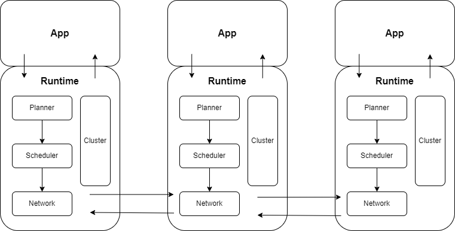

# datafusion-dist

[](https://crates.io/crates/datafusion-dist)
[](https://docs.rs/datafusion-dist/latest/datafusion_dist/)

A distributed streaming execution library for [Apache DataFusion](https://datafusion.apache.org/).

## Overview

datafusion-dist enables distributed query execution for DataFusion, allowing you to scale analytical workloads across multiple nodes.



1. The application sends a physical plan to the runtime, which returns data stream back to the application.
2. The cluster manages nodes and their states; the runtime sends heartbeats to the cluster periodically.
3. The planner breaks down the physical plan into stages.
4. The scheduler assigns stages to nodes based on cluster state.
5. The executor runs tasks.
6. The network layer handles communication between nodes.

### Example

Consider a SQL query: `SELECT * FROM t1 JOIN t2 ON t1.name = t2.name`

1. The application parses the SQL and creates a physical plan:
```
CoalesceBatchesExec: target_batch_size=8192
  HashJoinExec: mode=Partitioned, join_type=Inner, on=[(name@0, name@0)]
    CoalesceBatchesExec: target_batch_size=8192
      RepartitionExec: partitioning=Hash([name@0], 12), input_partitions=2
        DataSourceExec: partitions=2, partition_sizes=[1, 1]
    CoalesceBatchesExec: target_batch_size=8192
      RepartitionExec: partitioning=Hash([name@0], 12), input_partitions=2
        DataSourceExec: partitions=2, partition_sizes=[1, 1]
```

2. The application sends the physical plan to the runtime. The runtime uses the planner to break down the physical plan into stages:
```
===============Stage 0 (partitions=12)===============
CoalesceBatchesExec: target_batch_size=8192
  HashJoinExec: mode=Partitioned, join_type=Inner, on=[(name@0, name@0)]
    ProxyExec: delegated_plan=CoalesceBatchesExec, delegated_stage=2
    ProxyExec: delegated_plan=CoalesceBatchesExec, delegated_stage=1
===============Stage 1 (partitions=12)===============
CoalesceBatchesExec: target_batch_size=8192
  RepartitionExec: partitioning=Hash([name@0], 12), input_partitions=2
    DataSourceExec: partitions=2, partition_sizes=[1, 1]
===============Stage 2 (partitions=12)===============
CoalesceBatchesExec: target_batch_size=8192
  RepartitionExec: partitioning=Hash([name@0], 12), input_partitions=2
    DataSourceExec: partitions=2, partition_sizes=[1, 1]
```

3. The runtime uses the scheduler to assign stages to nodes:
```
0/{0,3,6,9},1/{0,1,2,3,4,5,6,7,8,9,10,11}->localhost:50060, 0/{1,4,7,10}->localhost:50070, 0/{2,5,8,11},2/{0,1,2,3,4,5,6,7,8,9,10,11}->localhost:50080
```

4. The runtime returns tickets to the application, which can use them to fetch the data stream.

## Features

- Distributed streaming execution for DataFusion plans
- Pluggable cluster management (PostgreSQL supported)
- Pluggable network layer (Tonic/gRPC supported)
- Extensible planner for custom stage planning
- Extensible scheduler for custom task scheduling
- Extensible executor for custom task execution

## Tracing

The library is instrumented with [fastrace](https://github.com/fast/fastrace). Libraries
depending on `datafusion-dist` do not need to enable anything: instrumentation compiles to
no-ops unless the application turns tracing on, so it has zero cost by default.

To collect traces, enable the `enable` feature and install a reporter in the application:

```toml
[dependencies]
fastrace = { version = "0.7", features = ["enable"] }
```

```rust,ignore
fastrace::set_reporter(
    fastrace::collector::ConsoleReporter,
    fastrace::collector::Config::default(),
);

// ... run the application ...

fastrace::flush();
```

Spans are only recorded when there is an active parent span. To trace a query end to end,
start a root span in the request handler (or let `fastrace-tonic` do it, see below) and run
the handler future with `fastrace::future::FutureExt::in_span`.

### Distributed context propagation

`datafusion-dist-network-tonic` injects the W3C `traceparent` header into every RPC it
sends. To continue traces on the receiving side, add `FastraceServerLayer` to the tonic
servers of each node:

```rust,ignore
use fastrace_tonic::FastraceServerLayer;
use tonic::transport::Server;

Server::builder()
    .layer(FastraceServerLayer::default())
    .add_service(DistTonicServiceServer::new(service))
    .serve(addr)
    .await?;
```

With the default extractor, requests without a `traceparent` header start a new trace,
so every incoming request is traced once a reporter is installed.

### Log correlation

The library logs through the `log` crate. fastrace does not collect those records by
itself, so an application that wants log lines and traces to reference each other uses
[logforth](https://github.com/fast/logforth), which can add the active span's ids to every
record and attach records to the span as fastrace events:

```toml
[dependencies]
logforth = { version = "0.30", features = [
    "starter-log",
    "diagnostic-fastrace",
    "append-fastrace",
] }
```

```rust,ignore
use logforth::{
    append, diagnostic, filter::rustlog::RustLogFilterBuilder, layout,
    record::{Level, LevelFilter},
};

let filter = || RustLogFilterBuilder::from_default_env().build();

logforth::starter_log::builder()
    // Regular logs keep RUST_LOG semantics and gain trace_id/span_id/sampled
    // fields whenever a span is active.
    .dispatch(move |d| {
        d.filter(filter())
            .diagnostic(diagnostic::FastraceDiagnostic::default())
            .append(append::Stderr::default().with_layout(layout::TextLayout::default()))
    })
    // Optionally, attach info and above to the active span as fastrace events.
    .dispatch(move |d| {
        d.filter(LevelFilter::MoreSevereEqual(Level::Info))
            .append(append::FastraceEvent::default())
    })
    .apply();
```

`RUST_LOG` keeps working exactly as with `env_logger`. The event dispatch is deliberately
limited to info and above: per-task details are logged at debug, and turning all of them
into events makes traces very large. Remove that second dispatch if log lines are enough.

Libraries should keep logging through `log` and leave the choice of backend and bridge to
the application.

### Instrumented spans

| Span | Key properties |
| --- | --- |
| `dist.runtime.submit` | `job_id` |
| `dist.planner.plan_stages` | `job_id` |
| `dist.scheduler.schedule` | `local_node`, `nodes`, `stages` |
| `dist.network.send_tasks` | `node`, `tasks`, `job_id` |
| `dist.runtime.receive_tasks` | `job_id` |
| `dist.runtime.execute_local` | `job_id`, `stage`, `partition` |
| `dist.task.execute` | task execution on the executor runtime |
| `dist.runtime.execute_remote` | `node`, `job_id`, `stage`, `partition` |
| `dist.network.execute_task` | `node`, `job_id`, `stage`, `partition` |
| `dist.proxy.get_df_batch_stream` | `node`, `job_id`, `stage`, `partition` |
| `dist.network.get_jobs` | `node` |
| `dist.network.cleanup_jobs` | `node`, `jobs` |

## Project Structure

```
datafusion-dist/
├── dist/                 # Core distributed execution library
├── clusters/
│   └── postgres/         # PostgreSQL-based cluster management
├── networks/
│   └── tonic/            # gRPC network layer using Tonic
└── integration-tests/    # Integration test suite
```

## License

This project is licensed under the MIT License — see the [LICENSE](LICENSE) file for details.